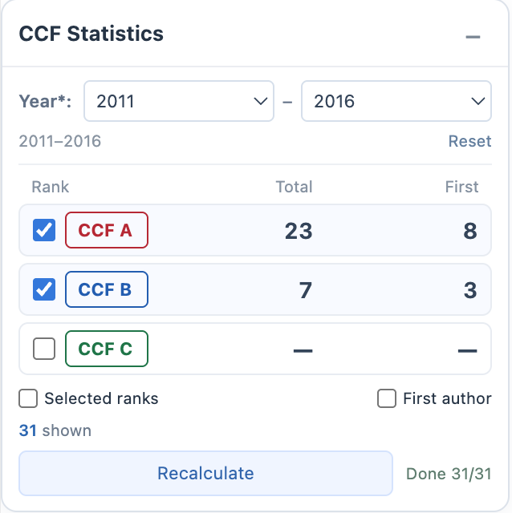
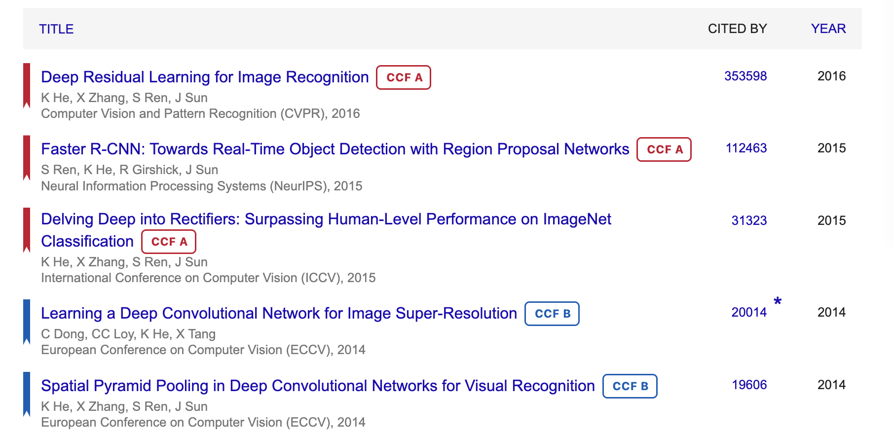

  

<h1 align="center">CCF Statistics for Google Scholar</h1>

CCF venue labels · Total and first-author counts · Year and rank filters

<a href="README.md">简体中文</a> · <strong>English</strong>

Display CCF A/B/C/N labels on Google Scholar author profiles, count total and first-author publications by year and selected rank, and filter the publication list.

Supports Chrome. The extension interface is in English and uses the CCF 2026 seventh-edition catalogue.

## Preview

Total and first-author counts by year and selected rank:

CCF labels and matching bookmarks in the publication list:

## Features

- **Automatic labels**: Show CCF labels for recognized conferences and journals when an author profile opens, regardless of author position.
- **On-demand statistics**: Select start and end years and A/B/C ranks, then click `Start statistics` to see total and first-author counts for each selected rank.
- **Year filtering**: Both year bounds are required. Narrowing or returning to an already-counted range updates results immediately. To include uncounted years, click `Update statistics`; existing lookup results are reused.
- **Display filters**: After statistics, use `Selected ranks` to show only selected ranks, or `First author` to show only first-author papers within those ranks.
- **Matching bookmarks**: After statistics, papers in selected ranks receive a left-side bookmark matching their label color.
- **Catalogue-first matching**: Match the local catalogue and cache first, handling common years, edition numbers, volume information and some truncated names. Use DBLP to complete venues that remain unresolved.
- **Request control**: While browsing, complete only nearby papers within the applied year range. During statistics, process only loaded papers within that range. A shared queue, rate limiting and caching reduce repeated requests.

| Label | Meaning | Included in statistics |
| --- | --- | --- |
| CCF A | An A-ranked conference or journal in the current catalogue | When A is selected |
| CCF B | A B-ranked conference or journal in the current catalogue | When B is selected |
| CCF C | A C-ranked conference or journal in the current catalogue | When C is selected |
| CCF N | A venue confirmed outside A/B/C, or a clearly identified non-main-conference record | No |

Unresolved venues, incomplete information and failed requests do not by themselves produce an N label.

## Installation

Download `ccf-scholar-1.0.0.zip` from this repository's **Releases**.

1. Extract the ZIP and keep all files.
2. Open `chrome://extensions/` in Chrome.
3. Enable **Developer mode** in the upper-right corner.
4. Click **Load unpacked** and select the extracted folder containing `manifest.json`.
5. Open or refresh a Google Scholar author profile.

To update, replace the files in the extension folder, click **Reload** on the extensions page, and refresh the Scholar profile.

## Usage

1. **Load publications**: Open an author profile and use Scholar's own loading button to show more papers as needed. Labels appear automatically for recognized venues.
2. **Choose a scope**: In the `CCF Statistics` panel above the citations section, select `Start`, `End` and the A/B/C ranks to count. Choose the same start and end year for a single year.
3. **Start statistics**: Click `Start statistics` to view `Total` and `First` counts. Completion is shown as `Done x/y`; unselected ranks display `—`.
4. **Filter the list**: Optionally enable `Selected ranks` and `First author`. These filters do not change the counts. With both unchecked, all loaded papers within the current statistical year range are shown.
5. **Update statistics**: After expanding into uncounted years, changing ranks or loading more papers, click `Update statistics`. Existing lookup results are reused.

`Reset` clears the year selection. Select valid start and end years again to enable statistics. A pending range change retains existing results; `Counted` identifies the range still being displayed. Completion can be paused, resumed, and retried for failed items.

To show the panel, click the extension icon in the browser toolbar and choose `Show statistics panel`.

## Counting and matching

- Counts cover **loaded publications only**, including both year bounds. Papers without a year are excluded.
- The extension does not automatically load more papers or request Scholar search or publication-detail pages.
- All venues use the **CCF 2026 seventh-edition** rankings, rather than historical rankings for each publication year.
- First-author detection uses the visible author list and profile name. Abbreviations, namesakes and incomplete information can introduce uncertainty. Shared first authorship is not inferred.
- Truncated names cannot always be confirmed locally. Distinctive name prefixes, verified annual editions and recognizable bibliographic information are matched locally where possible; other cases remain eligible for completion.
- Mixed proceedings are distinguished by the actual conference or track. A main-conference name alone does not give every record its rank.

## Privacy

Settings and venue caches remain in the browser. There are no analytics, ads or developer-operated servers. No extension account is required, and unrelated websites are not read.

To complete unresolved venues, the extension sends the **paper title and first-author surname** to DBLP over HTTPS. See the [privacy policy](PrivacyPolicy.md) for details.

## What's new

### 1.0.0

- CCF labels, total counts and first-author counts on Google Scholar profiles.
- Required year bounds, instant filtering within counted ranges and incremental completion for expanded ranges.
- A compact statistics panel, rank and first-author display filters, and matching bookmarks.
- Catalogue-first matching, cached DBLP completion and request control.

## Feedback

Bug reports and suggestions are welcome in this repository's **Issues**.

## License

The extension code is licensed under the [MIT License](LICENSE).

## Acknowledgements

Inspired by [CCFrank](https://github.com/WenyanLiu/CCFrank4dblp) and [Google Scholar Author Highlighter](https://chromewebstore.google.com/detail/google-scholar-author-hig/ijmngekkpaccbbjimedfkjpigplaikah). Thanks to the authors of both projects.

CCF catalogue data is adapted from this [catalogue mirror](https://github.com/haozhou-wong/ccf-recommended-list-2026-markdown), with the [official CCF catalogue](https://www.ccf.org.cn/Academic_Evaluation/By_category/) as the reference.
